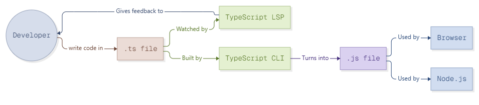

# Title : TypeScript Code Under the Hood During Compilation & tsConfig

# Introduction
TypeScript is very popular language for web development. But computers and browsers do not understand typescript directly. The code must go through  compilation. What exactly happens to typescript code under the hood during this time? Here we will explain the compilation steps simply.

# Description
Process starts when developer write code in `.ts file`. While writing, this `.ts file` is watched by TypeScript LSP. The TypeScript LSP gives feedback to the developer. This is how we see red lines for errors in our editor. 

After writing, the `.ts file` is built by TypeScript CLI. Here tsconfig.json play big role because it give rules to the CLI for how to compile the code. Then, the TypeScript CLI turns into `.js file`. 

Now typescript code is transformed into plain javascript. This final `.js file` can run anywhere now. The `.js file` is used by Browser. Or the `.js file` is used by Node.js. 



<h3> Now About What is tsconfig.json </h3>

```
tsConfig Basically define a few thing like : 

(1) Which files should be included and which should not 
(2)how strict the type checking should be 
(3) Where is source code should be and where to put the complied js file
(4)Which Js version to use
```

# Conclusion
In conclusion, typescript never runs directly on its own. You write in `.ts file` and get feedback from TypeScript LSP. Then TypeScript CLI turns into `.js file`. Finally this `.js file` is used by Browser or Node.js to run. It is simple workflow for developers to understand.